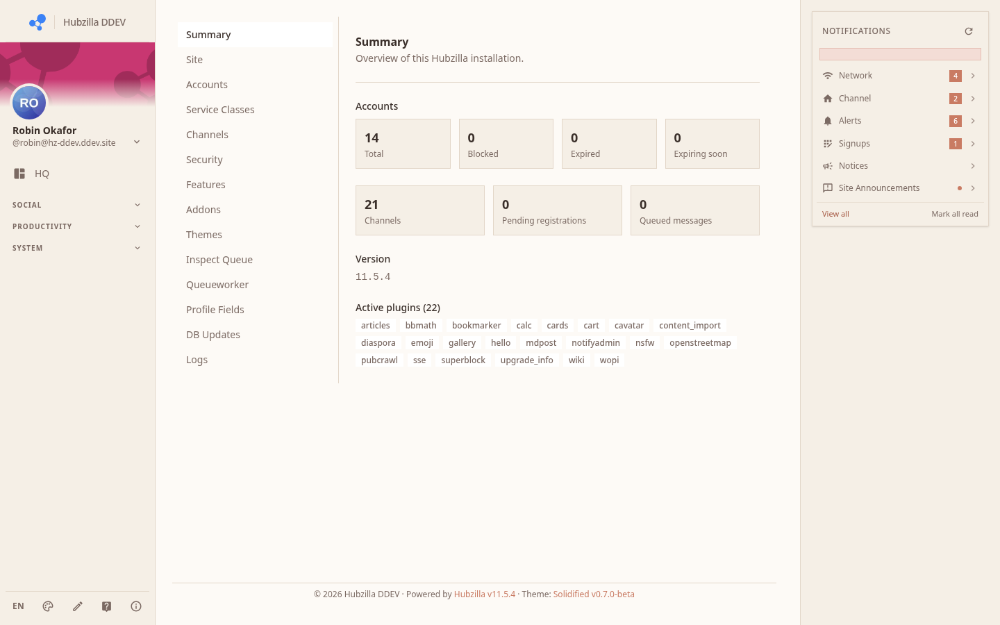

# Hubzilla *Solidified* - Admin Guide

This guide covers the Admin panel at `/admin`. It is visible only to accounts with administrator privileges.

## Contents

### Monitoring

- [Summary](summary): Site overview: user counts, queue, version, plugins
- [Logs](logs): System log viewer with level filtering
- [Queue](queue): Outbound message queue inspection
- [Database updates](db-updates): Pending database schema updates

### Configuration

- [Site](site): Site name, registration policy, access policy
- [Security](security): Block lists, allowlists, HTTP security headers
- [Features](features): Enable / disable optional site features
- [Themes](themes): Installed themes management
- [Addons](addons): Install and manage plugins/addons
- [Profile fields](profile-fields): Custom profile field definitions

### People

- [Accounts](accounts): Registered accounts: block, delete, paginate
- [Channels](channels): All channels on this hub

### Integrations

- [Jellyfin](jellyfin): The per-user Jellyfin player: what reaches the hub, what it stores, CSP and SyncPlay notes

## Accessing the Admin Panel

The Admin section is accessible only if your account has the administrator flag set. Navigate to `/admin` or use the **Admin** link in the action menu (bottom of the left sidebar).

The admin panel uses the same sub-page layout as Settings — a left list of sections and content on the right.

## Quick Health Check

1. Open **Summary** — check queue count. A large and growing queue means delivery problems.
2. Open **Logs** — filter to **Error** level. Any persistent errors here need attention.
3. Open **Accounts** — spot blocked or expired accounts that need review.
