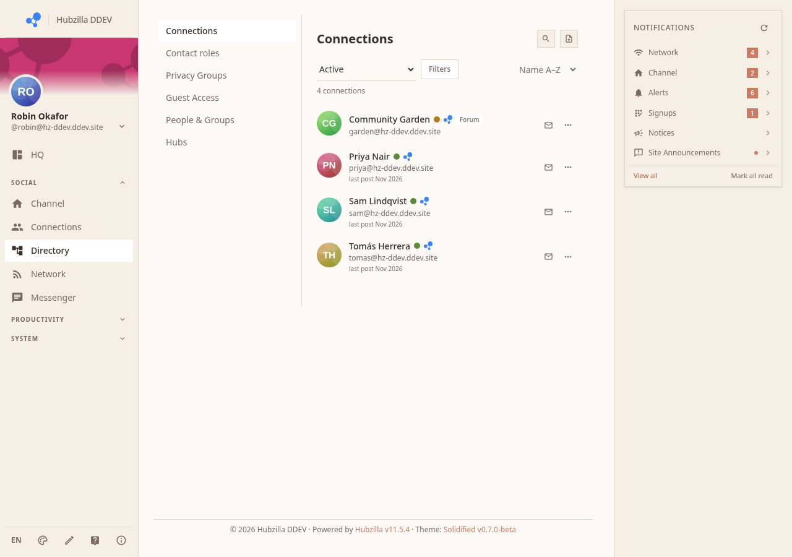
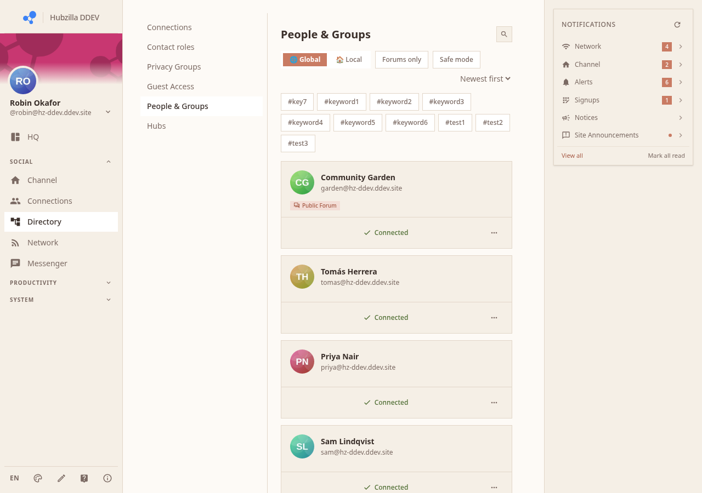
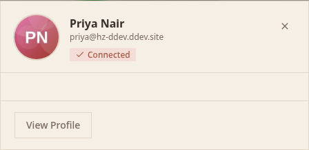
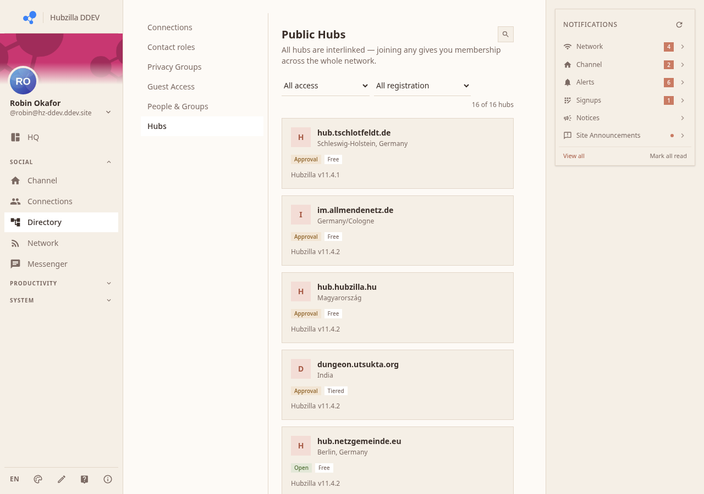
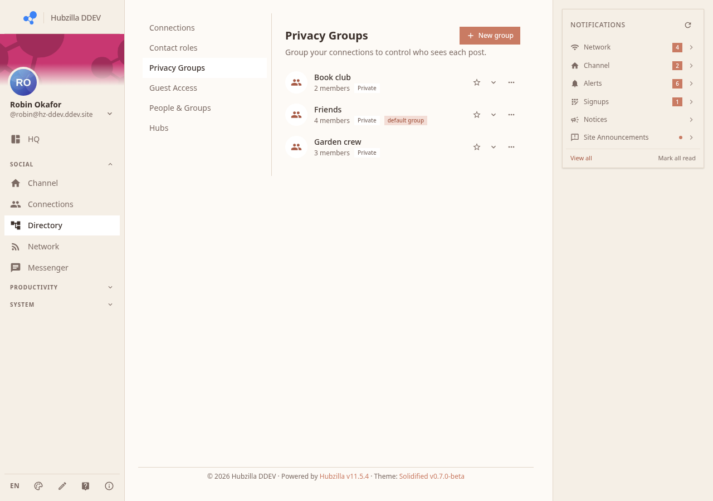
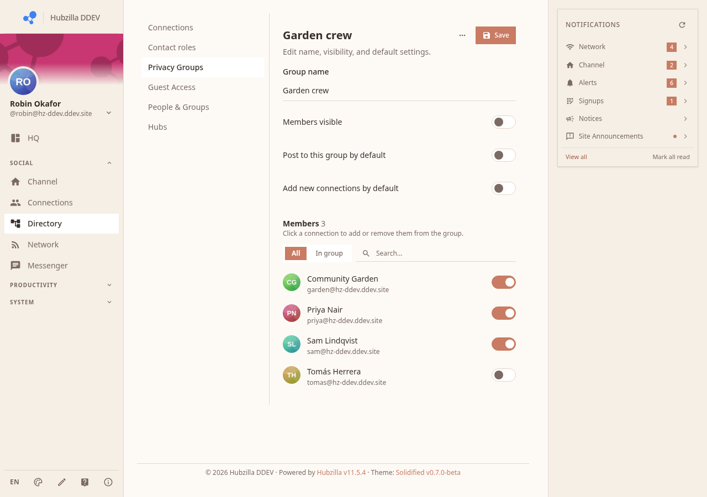
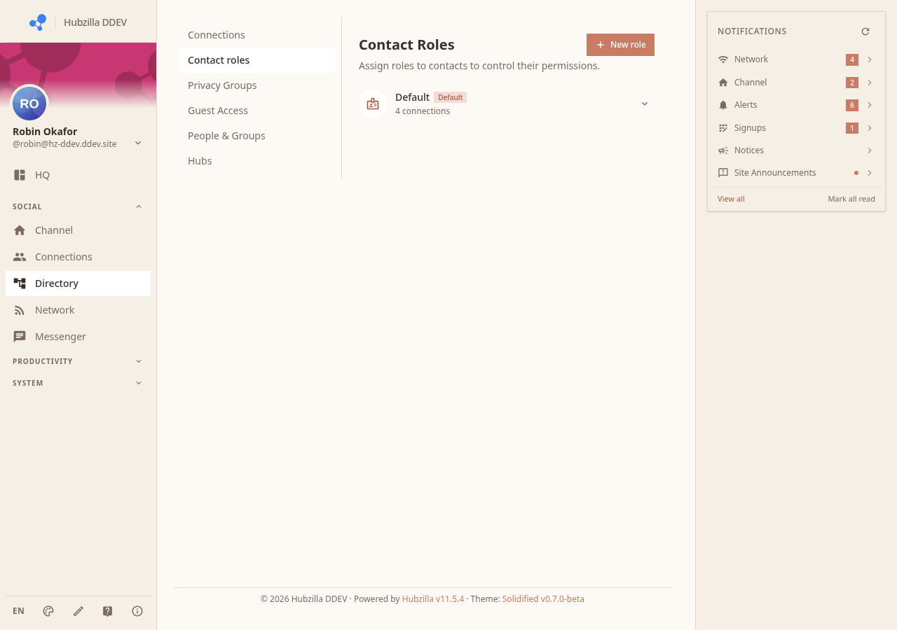

# Connections, Directory, and Privacy Groups

The Connections section (`/directory` or the Directory nav item) is where you manage who you are connected to, discover new people, and organise connections into groups.

## Your Connections

The **Connections** tab lists everyone you are currently connected to:
- Avatar and display name
- Channel address
- Connection role (friend, follower, following, etc.)
- Actions: view profile, edit role, remove

## Directory

The **Directory** tab lets you search and browse other channels on this hub and, if enabled, across the federation:

- Search by name or keyword
- Browse a card grid of public profiles
- Click a card to see a mini-profile modal with a Connect button

## Connected Hubs

The **Hubs** tab (if available) shows the federated hubs your account is aware of — remote servers that Hubzilla has communicated with.

## Privacy Groups

Privacy Groups let you organise your connections into named lists. You can then target posts to a specific group — only members of that group will see those posts.

### Creating a Group

1. Go to the **Privacy Groups** tab.
2. Click **New group**.
3. Give the group a name.
4. Add connections to the group by clicking their names.

### Using Groups When Posting

In the post composer, set the privacy to **Custom** and select one or more groups. Only the selected groups and individuals will receive the post.

### Contact Roles

The **Contact Roles** tab (if present) lets you define custom roles for your connections, which can be used in advanced permission settings.

## Sending a Connection Request

Visit someone's channel page and click **Follow** or **Connect**. A connection request is sent. Once they accept, you are connected and will see each other's posts in your respective streams.

## Managing Affinity

Each connection has an **affinity score** (0–100). Higher scores mean "closer" connections. You can use the affinity filter in the Network to show only posts from high-affinity connections.

Set affinity in the connection edit view (click a connection's name, then Edit).
