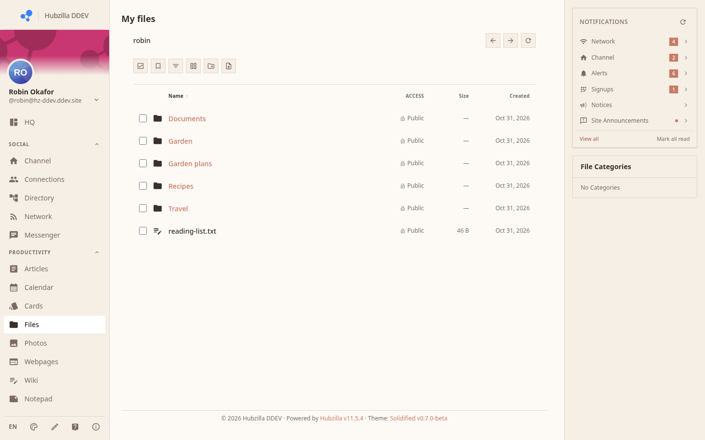
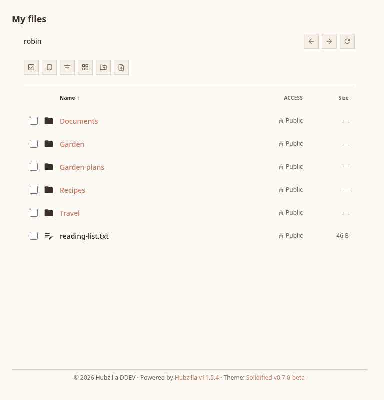
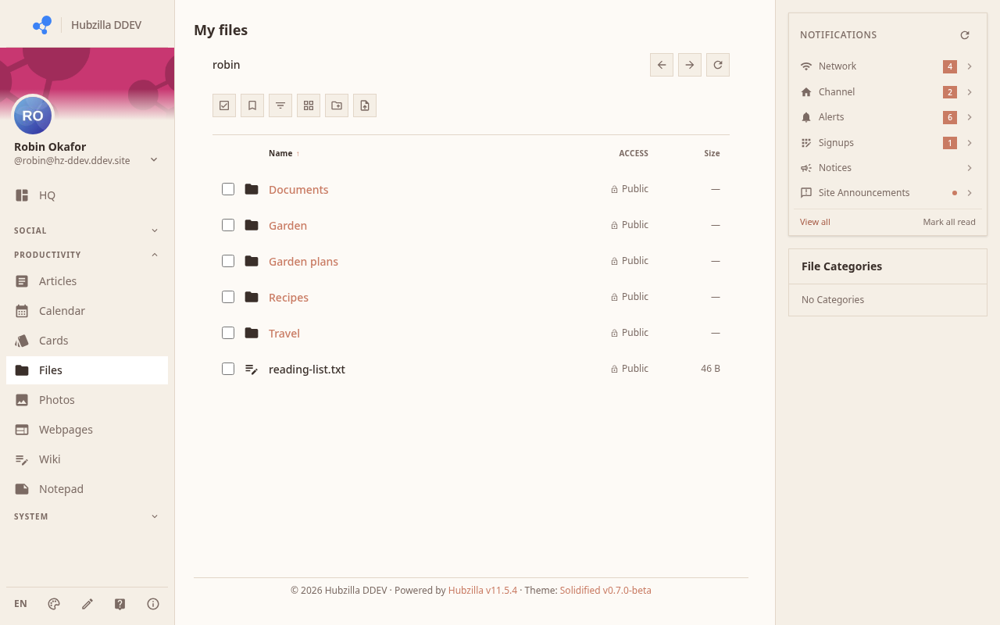

# Files (Cloud Storage)

The Files app (`/files` or via your channel's Cloud tab) gives you personal cloud file storage inside Hubzilla. You can upload, organise, and share files with connections or publicly.

## Browsing Files

The main Files view shows your files and folders in a list. Each row shows:
- File/folder icon
- Name
- Size
- Last modified date

Click a folder to navigate into it. Click a file to preview or download it.

## Uploading Files

Use the **Upload** button to add files from your device. You can upload multiple files at once.

## Folders

Organise files into folders:
- Click **New folder** to create a folder.
- Drag files into folders (if the interface supports it), or use the move action.

## Sharing Files

Each file has a shareable link. The link's visibility depends on the file's privacy setting:
- **Public** — anyone with the link can access it
- **Connections only** — only your connections can access it
- **Private** — only you

## Visiting Someone Else's Files

Navigate to `/files/<their-nick>` or click the Cloud tab on their channel to see files they have made public.

> **Note:** Cloud storage is enabled by the hub admin. If the Files tab is not visible, the feature may not be available on your hub.
