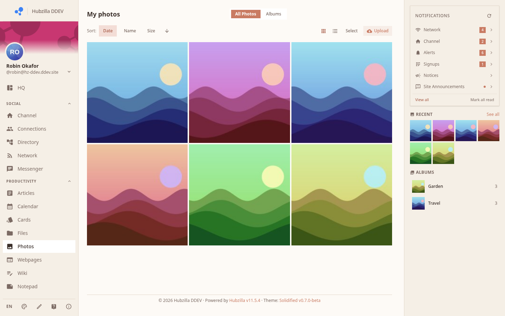
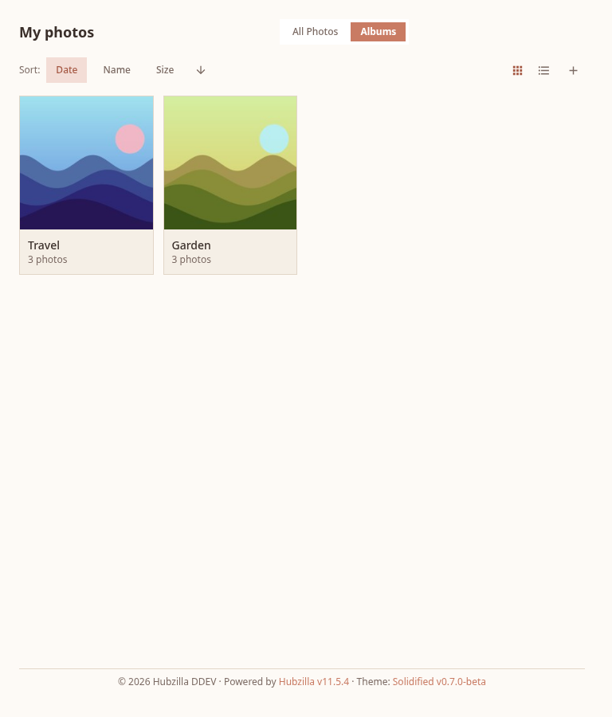
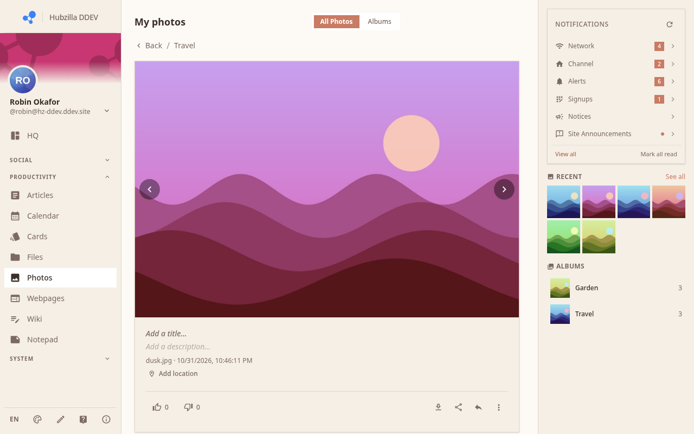
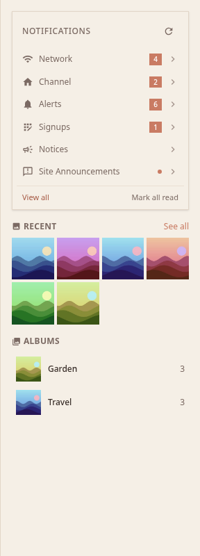
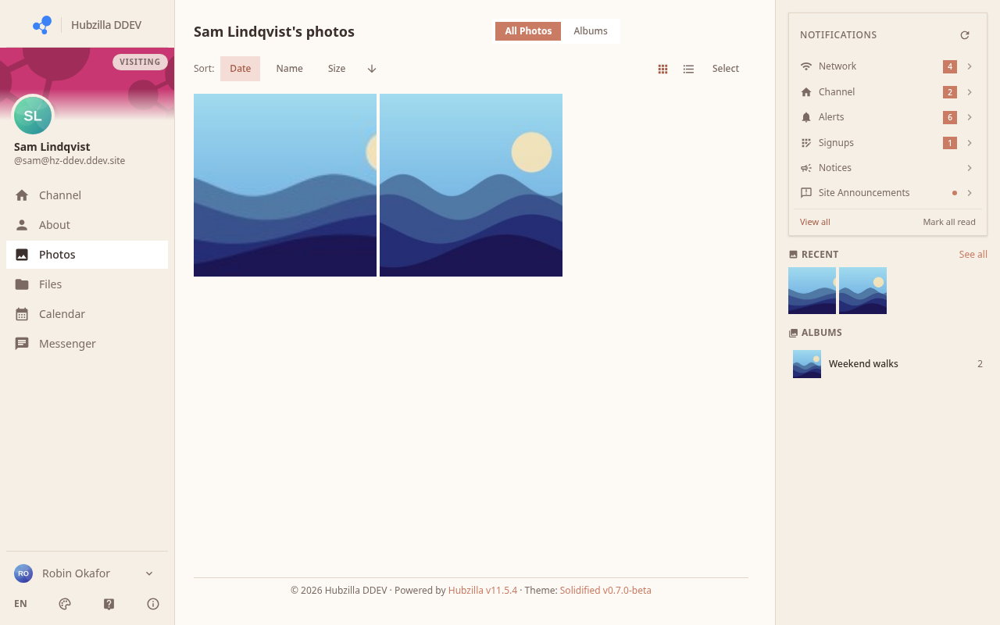

# Photos

The Photos app (`/photos/<nick>`) lets you organise and share images in albums.

## Albums

Your photos are organised into **albums**. The main Photos page lists all your albums as cards — each shows the album cover, name, and photo count.

- Click an album to open it and see the photos inside.
- Create a new album using the **+ New album** button (or equivalent action button).

## Viewing Photos

Inside an album, photos are displayed in a grid.

- Click a photo to open the **full-size image viewer**.
- The viewer shows the image, its title, and any description.
- Use the left/right arrows (or swipe on mobile) to navigate between images in the album.

## Right Sidebar Widgets

When you are on the Photos page, the right sidebar shows:

- **Recent photos** — a quick-scroll view of your latest uploads
- Other album-related shortcuts (if configured)

## Visiting Someone Else's Photos

Navigate to `/photos/<their-nick>` to see their public photo albums. You can browse albums and view images that they have made public.

## Privacy

Photos inherit the privacy settings of the album they are in. Only photos in public albums are visible to visitors and the wider network.

> **Tip:** To share a single photo publicly, place it in a public album.

## Photo Albums Widget

Shown in the sidebar on the Photos page — lists the channel's albums so visitors can jump straight to one without scrolling the main grid.

## Album Strip Widget

An opt-in showcase card that highlights one specific album you choose, with a thumbnail strip and a link to open it. Add it from the widget picker, then use its gear icon to pick the album; add several copies to feature more than one album.
