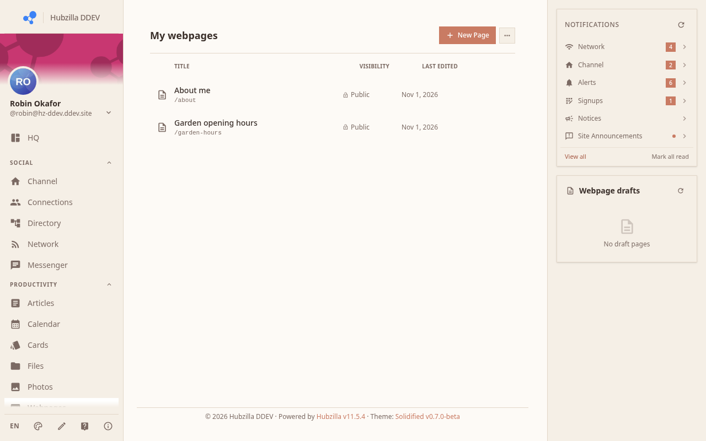
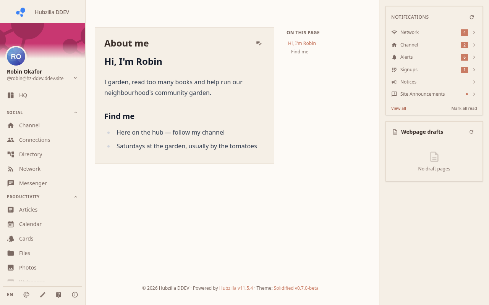
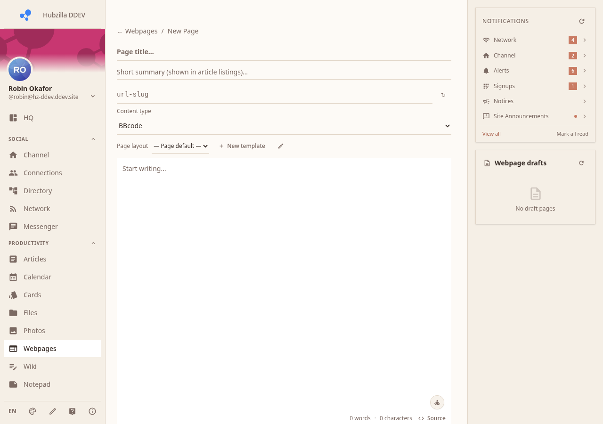

# Webpages

The Webpages app lets you create static pages attached to your channel — similar to a personal website or landing page. Each page has its own URL and can be made public.

Navigate to `/webpages/<nick>` to see a channel's pages.

## Listing Pages

The main Webpages view shows all published pages. Click a page title to read it.

## Reading a Page

Pages are rendered as formatted HTML from BBCode. They can contain text, images, links, and embedded content.

## Creating a Page

If you are the channel owner, click **New page** to create one. Give it:
- A **title** (shown as the page heading and in the listing)
- A **URL name** (the slug used in the page's address)
- **Content** (BBCode)
- **Privacy setting**

## Editing and Deleting

On your own pages, Edit and Delete actions are available from the page view or the listing.

> **Note:** The Webpages app must be installed on the channel.
