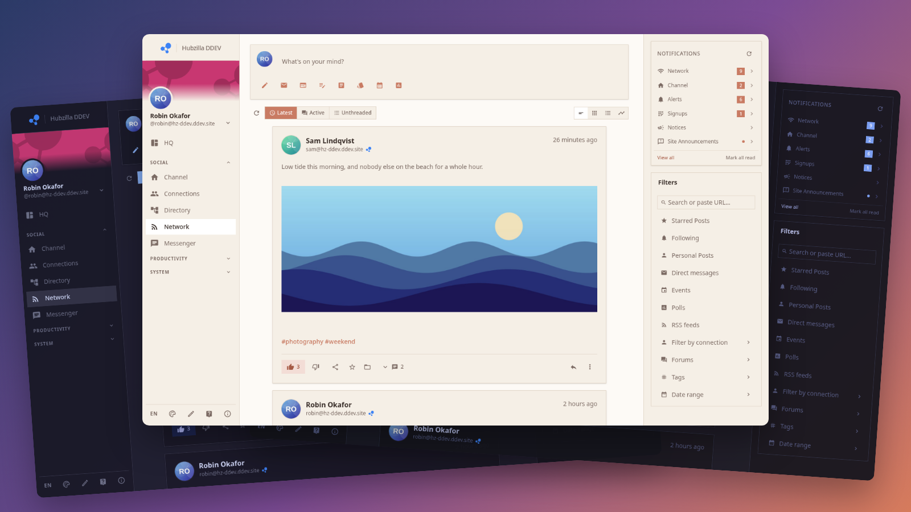

# Hubzilla *Solidified* - User Guide

**Solidified is the app you use to get around your Hubzilla hub.** Hubzilla is a social network, a cloud drive, a calendar and a publishing platform rolled into one, and it isn't owned by any one company. Solidified is the fast, modern interface on top of it.

## New to Hubzilla? The key ideas

You don't need to learn all of this up front, but these words come up everywhere in this guide:

| Word | What it means |
|------|---------------|
| **Hub** | The website you signed up on. Thousands of hubs run Hubzilla, run by different people, and they all talk to each other. |
| **Channel** | Your identity on the hub: your profile, your wall of posts, your photos and files. One account can hold several channels (say, a personal one and one for a club). |
| **Connections** | The people and channels you follow and who follow you. Your **Network** stream shows what they post. They can be on any hub, or on other networks such as Mastodon if your hub allows it. |
| **Federation** | The hubs share posts and comments with each other. Someone on another hub can follow you, reply to you and see your photos, just as if you were on the same site. |
| **Privacy** | You choose who sees each post, photo, file or event: everyone, only your connections, a group of people, or just one person. |
| **Apps** | Features you switch on as you need them, such as Wiki, Articles or Calendar. If something in this guide is missing from your menu, it's probably an app you haven't installed yet (see **Settings → Integrations**). |

## Why Solidified?

- **It's fast.** Moving between pages doesn't reload anything. Pages you've just visited appear instantly while fresh content loads in the background.
- **It's yours to arrange.** You can add, remove and reorder the small panels (widgets) around each page, and your layout follows you across devices.
- **It looks the way you want.** Choose from 24 colour themes or make your own.
- **It works like an app.** Install it on your phone or desktop, get notifications, and keep reading even when you're offline.
- **It's still Hubzilla.** Everything you post reaches everyone, exactly as before. Solidified changes how the hub looks, not how it works.

## Start here

1. **[Find your way around](getting-started).** Logging in, the layout of the screen, and how to move between pages.
2. **[Write your first post](composing-posts).** Formatting, adding pictures, and choosing who can see it.
3. **[Connect with people](connections).** Find channels to follow and organise them into groups.

After that, your **[HQ](hq)** is your home page, and the **[Network](network)** stream is where you'll spend most of your time.

## The guide

### Getting around

- [Getting started](getting-started): logging in, the screen layout, mobile vs desktop
- [Navigation](nav): what every menu link and button does
- [Search and jump](search): Ctrl+K to find anything you've written or saved, or jump to any app
- [Notifications](notifications): the bell, and staying on top of replies and mentions
- [Widgets](widgets): arranging the panels around each page
- [Settings](settings): display, profile, privacy, notifications and account

### Social

- [HQ](hq): your dashboard, with the composer, events, messages and drafts
- [Network](network): posts from your connections, with filters, views and search
- [Inbox](inbox): a mail-style reader for messages, which also works offline
- [Channel](channel): your wall and profile, which is what visitors see
- [Composing posts](composing-posts): writing, formatting, privacy and reactions
- [Connections](connections): connections, the directory and privacy groups
- [Chat](chat): chatrooms

### Your content

- [Photos](photos): albums and the image viewer
- [Files](files): your cloud storage
- [Articles](articles): long-form writing
- [Cards](cards): short notes, decks and kanban boards
- [Wiki](wiki): pages you write alone or together
- [Webpages](webpages): static pages on your channel
- [Notepad](notepad): a private scratchpad
- [Calendar](calendar): events and invitations
- [Links and graph](links-and-graph): `[[links]]` between your pages, "Linked from", and a map of how it all connects

### Creative tools

- [Diagrams](diagrams): flowcharts, sequence diagrams and charts written as text
- [Excalidraw](excalidraw): a hand-drawn-style whiteboard

### Media and extras

- [Jellyfin](jellyfin): music and video from a Jellyfin server, with sharing and watch parties
- [Games](games): puzzle games
- [Cart](cart): shopping, checkout and orders

### Coming from classic Hubzilla?

- [Switching from Redbasic and other themes](cross-compat): what carries over, and what works differently

## Quick tips

- **Looking for something?** Press **Ctrl+K** (or use the search in the mobile app drawer) to search everything at once.
- **Lost?** Turn on contextual help (the **?** icon under the menu), then tap any part of the screen to see what it does.
- **Missing a feature?** Install its app in **Settings → Integrations**.
- **All your settings** are in the account menu, at the bottom of the left sidebar on desktop or in the bottom bar on mobile.
- **On your phone?** Use your browser's "Install" or "Add to Home Screen" option to get Solidified as an app.
