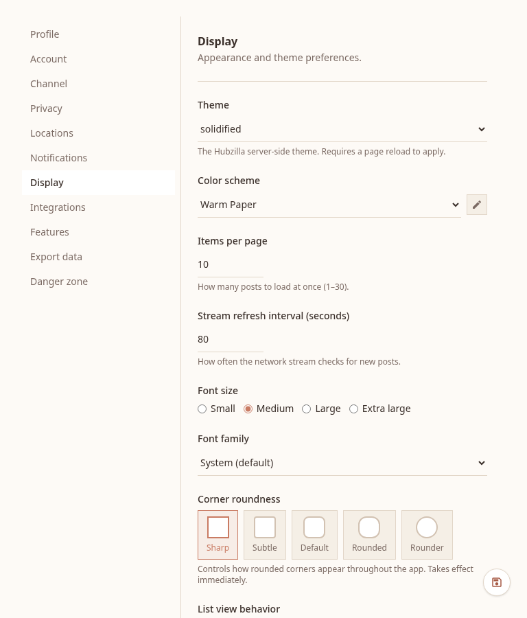
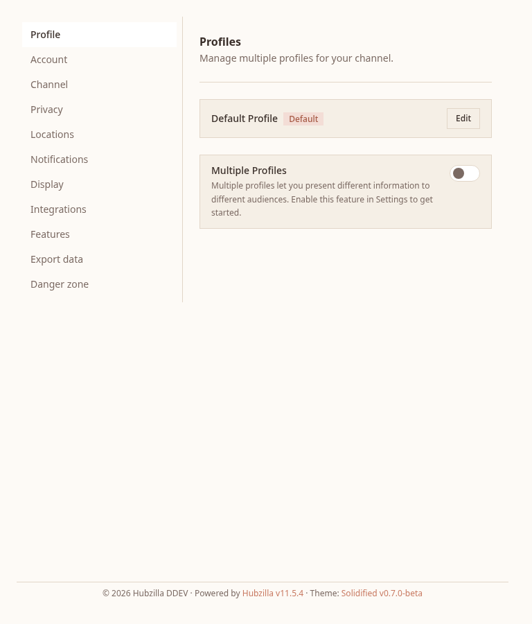
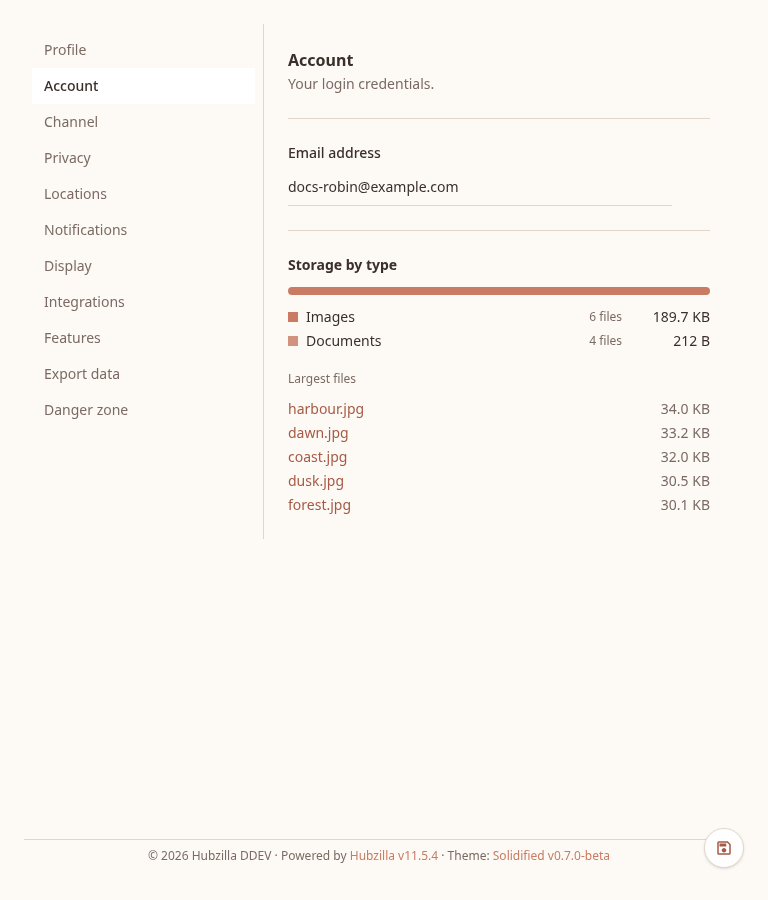
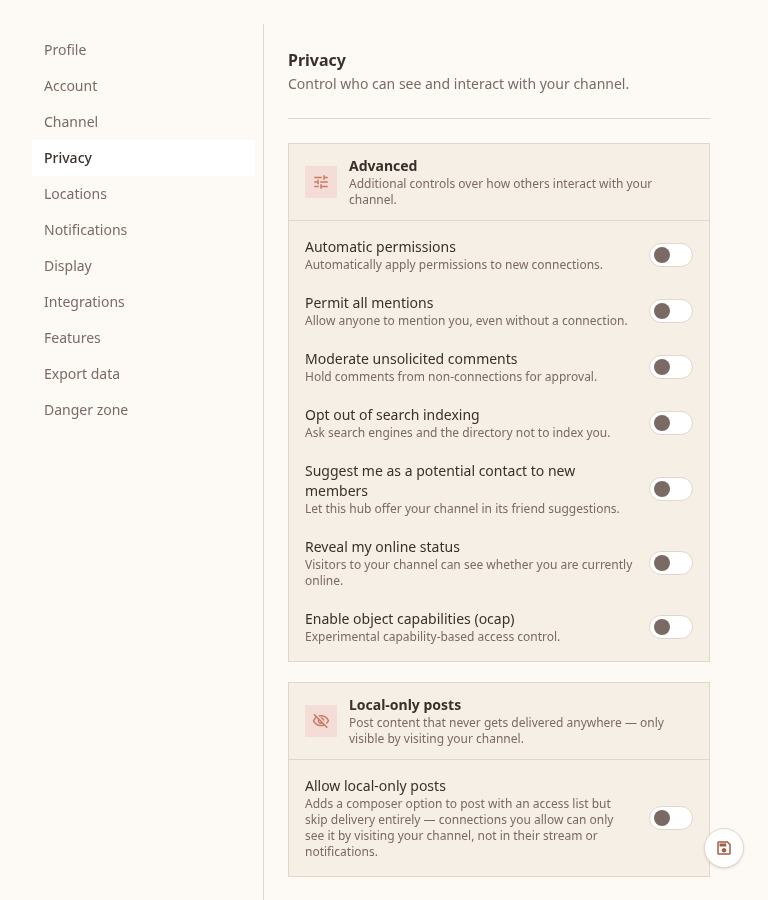
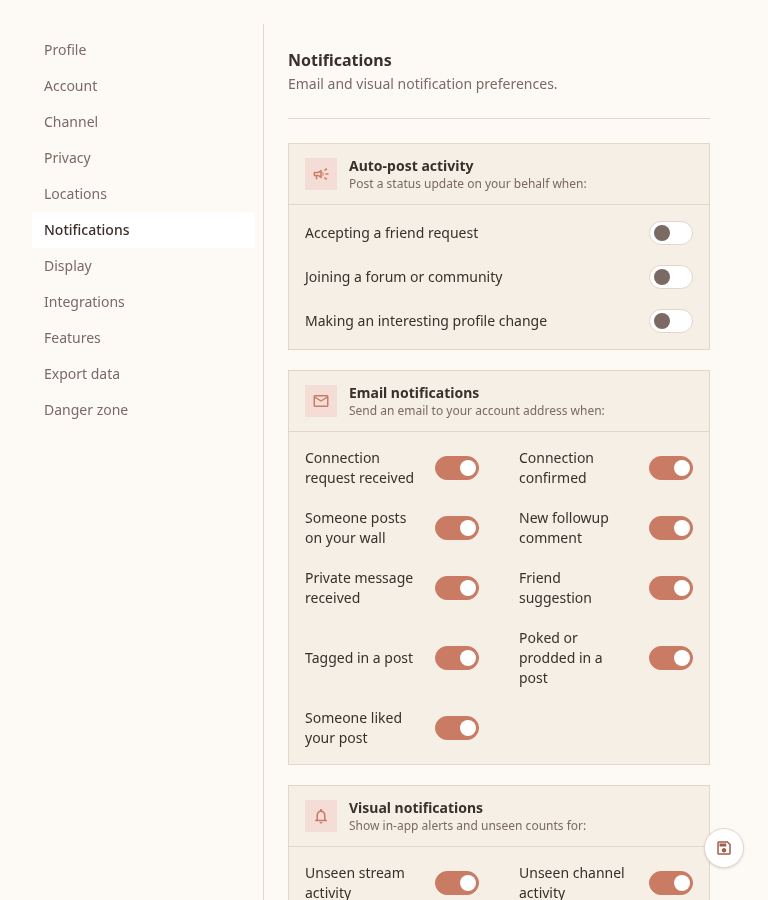
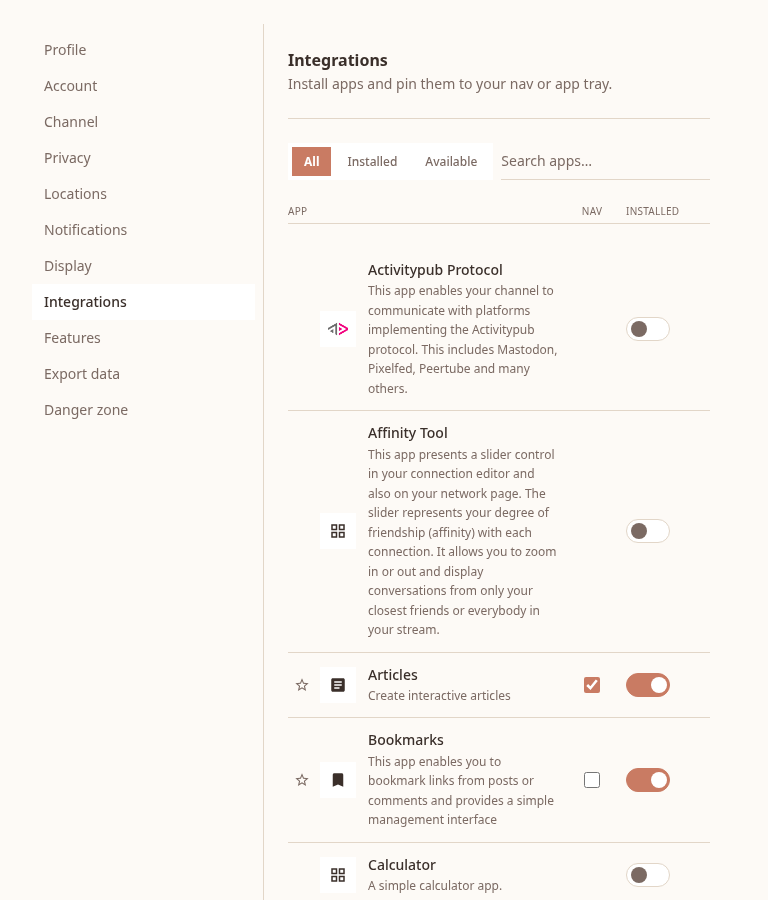
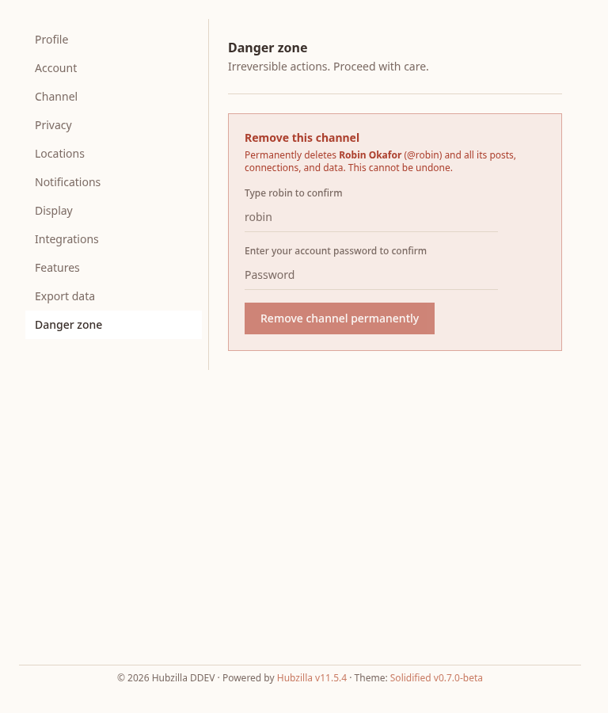

# Settings

Settings are at `/settings`. The left panel lists the sections; click one to
open it on the right. On a phone the list comes first, and **Back** returns to
it.

Most sections have a **Save** button that floats at the bottom right (on a
phone it's in the page actions). Options marked "takes effect immediately"
apply as soon as you change them, before you save.

---

## Profile

Your public profile: what people see when they visit your channel.

| Field | What it does |
|-------|-------------|
| **Display name** | Your visible name across the network |
| **Short description** | A one-liner about you, e.g. "developer, photographer" |
| **Hometown** | Where you're from or based |
| **Gender** | Optional, shown on your profile |
| **Birthday** | `YYYY-MM-DD`, or `MM-DD` to leave out the year |
| **Homepage** | A web address shown on your profile |
| **About** | A longer bio. Supports BBCode |
| **Keywords** | Comma-separated interests, used for search and friend suggestions |
| **Hide my connections list from others** | Visitors can't see who you're connected to |
| **Publish my profile in the network directory** | Lets people find you in the directory |

### Multiple profiles

With the **Multiple Profiles** feature on, **Profiles** lists every profile
you have. **New Profile** creates one, and **Edit** and **Delete** manage it.
The one marked **Default** is what everyone sees unless you assign them another.

Under **Visible to** you choose which connections see a profile instead of
your default one. Add them one by one, or pick a contact role or privacy group
and click **Add everyone**. Each connection sees only one profile, so adding
someone here moves them away from the profile they saw before.

---

## Account

Your login and what your account uses.

- **Email address**: where your account's mail and email notifications go.
- **Usage & Limits**: limits the hub admin has set for your account (channels, storage, and so on) and how much of each you've used.
- **Storage by type**: how your cloud storage splits into images, video, audio, documents and other files, with your **Largest files**, which are good candidates to delete if you're running out of space.

---

## Channel

Basic configuration for the channel you're using now.

<!-- channel_role -->
### Channel role

The **Channel role** is a permission preset: a social channel, a forum, a
personal journal and so on. It sets who can see your posts, comment, send you
messages and more.

**Permission limits → Configure…** lets you fine-tune each permission ("who
is allowed to do each of these things"). Choosing a different role resets
these limits to the new role's defaults. Changes apply when you save.

<!-- channel_basics -->
### Basics

- **Channel timezone**: the timezone your dates and events are shown in.
- **Default post location**: a place name added to your posts. **Use browser location** fills it in from your device.
- **Adult content**: mark this channel as one that regularly publishes adult content.
- **Maximum friend requests per day**: limits incoming connection requests to cut down on spam. 0 means no limit.
- **Act as a group/forum channel**: makes the channel work as a forum. Posts sent to it are shared with all its members.

<!-- content_and_import -->
### Content & import

- **Default photo upload folder** / **Default file upload folder**: where uploads land in your cloud storage. `%Y` becomes the current year and `%m` the current month, so `photos/%Y-%m` sorts uploads by month.
- **Expire other channel content after this many days**: deletes posts from other channels after that many days. 0 or blank uses the hub's limit. If both are set, the lower one wins.
- **Only import posts with this text** / **Do not import posts with this text**: filters for what reaches your stream. Put one rule per line: a word, a `#tag`, a `$category`, a `/pattern/`, or `lang=xx` / `lang!=xx` for a language. Leave both blank to import everything.

---

## Privacy

Who can see your channel and interact with it.

<!-- advanced_privacy -->
### Advanced privacy options

| Setting | What it does |
|---------|-------------|
| **Automatic permissions** | Apply your default permissions to new connections automatically, without approving each one |
| **Permit all mentions** | Anyone can @mention you, even without a connection |
| **Moderate unsolicited comments** | Comments from people you aren't connected to wait for your approval |
| **Opt out of search indexing** | Asks search engines and the directory not to index you |
| **Suggest me as a potential contact to new members** | This hub may suggest your channel to new members |
| **Reveal my online status** | Visitors can see whether you're online right now |
| **Enable object capabilities (ocap)** | Experimental capability-based access control. Leave it off unless you know you need it |

<!-- local_only_posts -->
### Local-only posts

**Allow local-only posts** adds an option to the composer's privacy picker:
the post keeps its audience but is never delivered anywhere. The people you
allowed can read it only by visiting your channel. It won't appear in their
streams.

---

## Locations

The hubs where your channel lives. A channel can have copies (clones) on
several hubs, so it keeps working if one of them goes down.

- **Sync now**: pushes your channel's current state to every location.
- **Set as primary location**: makes that hub your main address.
- **Drop this location**: removes your channel from that hub. Click **Confirm drop** to finish, or **Cancel**.

---

## Notifications

What you're told about, and how.

<!-- auto_post_activity -->
### Auto-post activity

Posts a status update for you when you accept a friend request, join a forum
or community, or make an interesting profile change.

<!-- email_notifications -->
### Email notifications

Sends an email to your account address for each event you tick: connection
requests and confirmations, wall posts, follow-up comments, private messages,
friend suggestions, being tagged, being poked, and likes on your posts.

<!-- visual_notifications -->
### Visual notifications

Chooses what counts toward the in-app notification bell and unseen badges:
stream, channel and private-message activity, events, birthdays, system
messages, new connections, shared files, likes, forum posts, public stream
activity and (for admins) new registrations.

<!-- other_notification_options -->
### Other

- **Show new wall posts and messages under Notices**: lists them in Notices as well as in the stream.
- **Mark entire thread read when clicking a notice**: opening a notice also marks the rest of its thread as read.
- **Show oldest notifications first**: reverses the order of the list.
- **Event advance notice (days)**: how many days ahead you're reminded of upcoming events.
- **Desktop notifications**: shows a system notification for new activity while this tab isn't focused.
- **Push notifications**: notifies you even when Hubzilla isn't open in any tab.

If either notification switch says it's blocked, allow notifications for this
site in your browser's site settings, then try again.

---

## Display

How the interface looks and behaves. These settings belong to you, so they
follow you to any device you log in on.

**Look**

- **Color scheme**: pick a preset. **Copy these colors into Custom** starts a custom scheme from the current one. **Custom theme colors** lets you set the background, text and accent, plus **Dark mode** and **Advanced colors** for finer control. Anything you leave unset is derived from those three, and **reset** puts a color back.
- **Font size** and **Font family**: the fonts are grouped by style. The Accessibility group includes OpenDyslexic.
- **Corner roundness**: how rounded cards, buttons and panels are.
- **Background**: a preset image or pattern, or a **Custom URL**. **Clear** removes it.
- **Widget style**: how sidebar and page widgets are framed (card, section, rail, fold and more). Visitors to your pages see your choice.
- **Translucent surfaces**: lets your background show through cards and sidebars. The blur can slow scrolling on low-end phones.
- **Theme**: the classic Hubzilla server theme. It needs a page reload.

**Reading**

- **Items per page**: how many posts load at a time (1 to 30).
- **Stream refresh interval**: how often (in seconds) the network stream checks for new posts.
- **Scroll style**: **Endless scroll**, or a **Load more** button at the bottom.
- **List view behavior**: in list view, a post opens in a window (**List**) or expands in place (**Inbox**).
- **Comment view** and **Comment order**: how replies are laid out, and whether the oldest or newest load first.
- **Post height**: how tall a post can get before it's folded behind "Show more". 0 means never fold.
- **Show emoticons as images**: shows `:shortcode:` emoji as pictures instead of text.

**Writing**

- **Composer window** and **Post window**: whether the composer and opened posts start as a window, docked, or full screen. You can still change each one while it's open.
- **Mention the author when replying**: starts each reply with `@author` so they're notified.

**Widget layout → Reset layout to default** puts the widgets on every page
back where they started.

---

## Integrations

Apps add features to your channel. This list is where you install them and
choose where they appear.

- **Search apps…** filters the list.
- **Installed** turns an app on or off for this channel. **Install** and **Remove** do the same from the app's row.
- **Nav**: **Show in nav** pins the app to your sidebar. **Hide from nav** keeps it installed, but only in the app tray.
- **Configure** opens an app's own settings, where it has any.
- **Frontend** marks features of this interface (like Inbox, Tools and Games) rather than server apps. Turning one off only hides it here.

---

## Features

Optional channel features from the server, such as multiple profiles,
categories and post expiry, plus editor extras like the diagram and LaTeX
buttons. Switch each one **On** or **Off**. A feature marked **Set by your hub
admin** is fixed for every channel on this hub.

---

<!-- blocked -->
## Blocked channels

Hides a channel's posts, comments and search results from you. This needs the
**Superblock** app.

- Type a channel address (`name@example.com`) and click **Block**. Set **Block for** a number of days or weeks to make the block temporary. Leave it at 0 to block permanently.
- **Unblock** removes a block. Expired blocks are marked "block expired".
- **Block reshares from blocked channels**: also hides reshares of a blocked channel's posts by people you haven't blocked.
- **Block incoming posts and activities**: drops blocked content as it arrives. It isn't stored at all, so it won't come back when the block ends.

---

## Portability

Take a copy of your channel with you, or bring one in. This needs the
**Channel Export** app.

- **Export channel**: your identity and connections as one file. Choose the **Sections to include**, then **Download export**. Use this file to move your channel to another hub.
- **Export content**: posts, comments, messages, articles, cards, notes and drafts, one zip per **Year**.
- **Files & photos**: everything in your cloud storage as one zip. This can be large.
- **Calendars & address books**: your CalDAV calendars (`.ics`) and CardDAV address books (`.vcf`).
- **Import content**: adds the content from an export file (`.json` or a yearly `.zip`) to the channel you're using now. Import the oldest year first.
- **Import channel**: restores or moves a whole channel to this hub from an export file.

---

<!-- danger -->
## Danger Zone

Actions that can't be undone.

**Remove this channel** deletes the channel you're using now, with all its
posts, files and connections, from this hub and all its locations. To
confirm, type the channel's nickname, enter your account password, then click
**Remove channel permanently**.

> Download an export first (see Portability) if you might want anything back.
