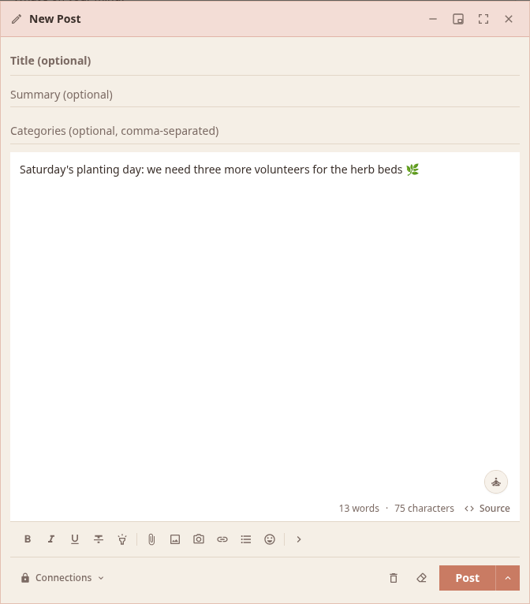
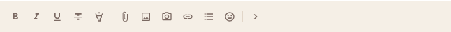
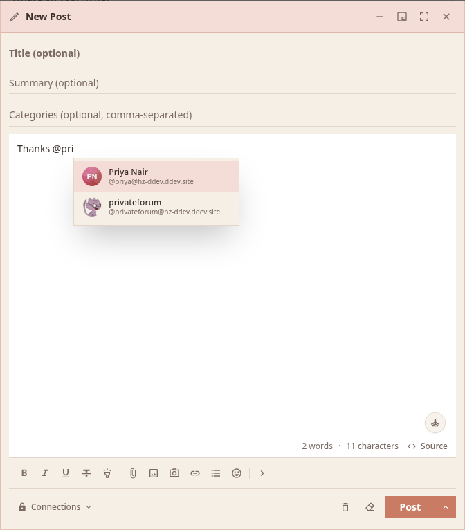
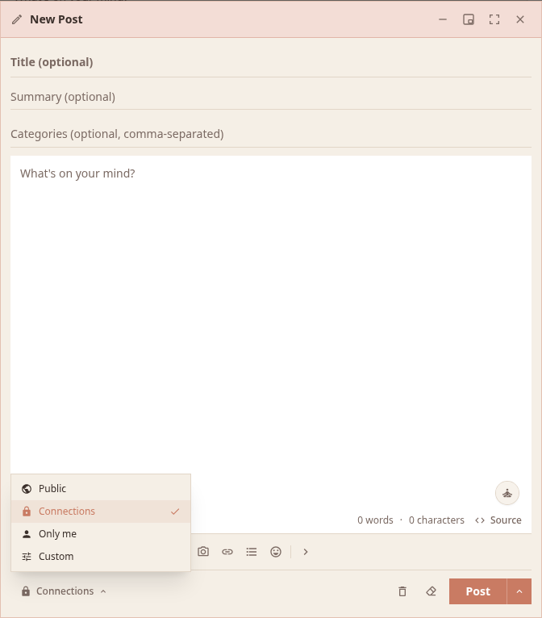
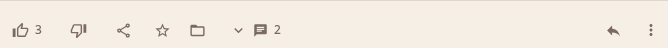
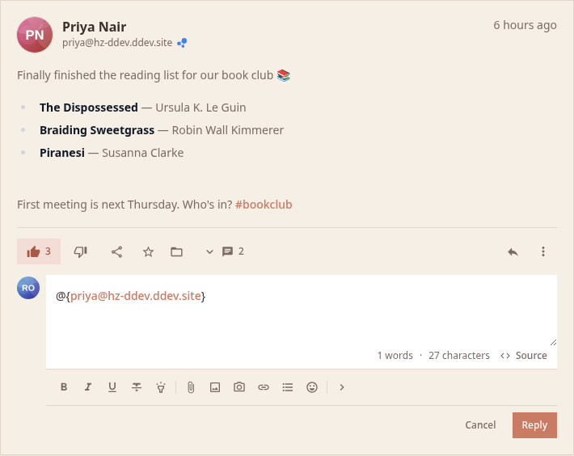
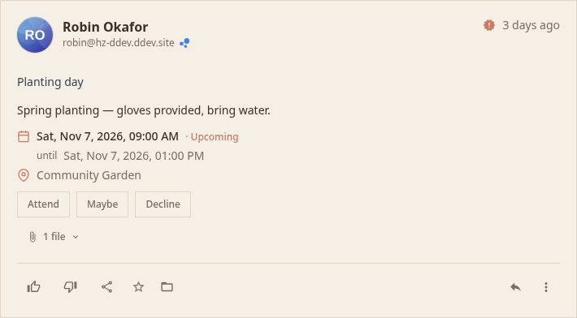

# Composing Posts

You can write a post from your HQ dashboard or from your channel wall. The composer works the same way in both places.



## Writing Your Post

Click the text area to open the full composer. Type your post in the text area. Posts support **BBCode** formatting — the toolbar inserts tags for you, or you can type them manually.

### Formatting Toolbar

The toolbar sits under the text. Hover any button to see its name and
keyboard shortcut.

- **Text styles**: bold, italic, underline, strikethrough, highlight, and in the full editor text color, font, size, superscript and subscript.
- **Structure**: headings, lists, quote, code block, horizontal rule, and in the full editor tables and spoilers (a section readers click to open).
- **Insert**: a link (**Ctrl+K**), an image, video or audio link, and the attachment, equation, diagram, card, drawing and map buttons described below.
- **More formatting** (the **›** button) shows the less common tools. Click it again for fewer.
- In the full editor: **Outline** (jump to a heading), **Find and replace** (**Ctrl+F**), **Undo**/**Redo**, and **Clear formatting**.

Select text first, then click a button to format it. If nothing is selected,
the button applies to what you type next. Type `/` at the start of a line for
a quick menu of the same tools. Which buttons appear depends on the format
you're writing in. Plain text has none, for example.



## Writing in Markdown

If you turn on **Markdown** in Settings → Features → Editor, the composer accepts
Markdown as well as BBCode. Your post is converted to BBCode when you publish it,
so everyone sees it correctly — including people on the classic Hubzilla themes
and on other networks.

### Basic syntax

| You type | You get |
|---|---|
| `**bold**` or `__bold__` | **bold** |
| `*italic*` or `_italic_` | *italic* |
| `# Heading` | a heading |
| `> quoted` | a quote |
| `- item` | a bullet list |
| `1. item` | a numbered list |
| `` `code` `` or ```` ```block``` ```` | code |
| `[label](https://example.com)` | a link |
| `` | an image |

### Extended syntax

| You type | You get |
|---|---|
| `~~struck~~` | struck-through text |
| `- [ ] task` / `- [x] done` | a checklist |
| `==highlight==` | highlighted text |
| `H~2~O` | subscript |
| `X^2^` | superscript |
| `see [^1]` and `[^1]: the note` | a footnote |
| a table written with `\|` pipes | a table |

Footnotes show up in the composer where you typed them — the reference as a
small superscript, the note itself set apart just below. That is on purpose: the
composer shows your text as you wrote it rather than rearranging it while you
are still writing.

### Two things Markdown cannot do

**There is no underline in Markdown.** `__text__` means **bold**, exactly like
`**text**` — that is standard Markdown everywhere, not a quirk of this theme.
For underline, use the toolbar's **U** button, which inserts `[u]…[/u]`.

The same goes for text colour, highlight colour, font, size, spoilers and
centred text: the toolbar inserts BBCode for those, and you can mix BBCode and
Markdown freely in the same post.

## Mentioning Someone

Type `@` followed by a name to mention a connection. A popup appears with matching names — select one to insert a proper mention link.



## Privacy Controls

The **privacy picker** (below the text area) controls who can see the post:

| Setting | Who sees it |
|---------|------------|
| **Connections** | Everyone you are connected to |
| **Public** | Anyone, including visitors and the public stream |
| **Custom** | Choose specific connections or privacy groups |
| **Myself** | Private — only you |

Click the privacy picker to change the setting. For Custom, a selector opens where you can add or remove specific people and groups.



## Attachments

- **Attach file from device** (paperclip): uploads a file to your cloud storage and adds it to the post. Images and videos show inline, other files as a download link. You can also drag files onto the composer or paste an image.
- **Browse existing files and photos**: picks something you've already uploaded.
- **Capture photo or video**: uses your camera. On a phone, **Use device camera app** opens the phone's own camera instead.

Attached files get the same audience as the post, so people who can see the
post can open them.

## Math and LaTeX

**Insert LaTeX equation** (Σ) writes a formula in LaTeX, e.g.
`e^{i\pi} + 1 = 0`. Choose **Inline** (inside a sentence) or **Block
equation** (on its own line), check the **Preview**, then **Insert**. In posts
the equation is added as an image, so it shows correctly on every Hubzilla
theme and other platforms. Turn the button on in **Settings → Features →
Editor**.

## Embedding Cards and Posts

**Insert a card** picks one of your cards and embeds it in the post as a
compact preview with a link. Embedding someone else's post works the same
way: use **Share → Share as post** in that post's menu. Private posts can't be embedded.

## Maps

**Insert map** adds a map: search a **Place** (or **Use my location**), set the
**Zoom**, and click **Insert**. Readers see an interactive map.

## Post Options

The buttons at the bottom right of the composer:

- **Post** publishes. The 🗑 button (**Discard**) closes the composer and keeps a draft, and the eraser (**Clear composer**) empties it.
- The **⌃** next to Post (**More options**) opens the extra options for this post:
  - **Location**: adds a place name, or exact coordinates with **Use browser location** or **Pick on map**.
  - **Set publish date**: schedules the post. It stays hidden until then (needs the *Delayed Posting* feature).
  - **Expires**: deletes the post at a date you choose (needs *Content Expiration*).
  - **Disable comments**: nobody can reply (needs *Disable Comments*).
  - **Local only (don't deliver)**: the post keeps its audience but isn't sent anywhere. Readers have to visit your channel (turn it on in **Settings → Privacy**).
  - **Add poll**: adds options people vote on. Set when it **Expires in**, and whether to **Allow multiple answers**.
  - **Encrypt**: locks the post with a password. Readers need the password (tell them separately) and see your optional **Hint**. To change it later, use **Decrypt to edit**.

Features are switched on in **Settings → Features**. An option you don't see
probably needs one turned on.

## Direct Messages

The **New message** composer sends a private message to the people you add
under **To**. Only connections who are allowed to receive private messages
from you can be added; if someone isn't allowed, the composer tells you before
anything is sent.

**Add Bcc** sends each Bcc recipient their own separate copy, so they don't see
each other or the people under To. Direct messages can be scheduled and saved
as drafts like any other post, and they show up in your **Inbox**.

## Submitting

Click **Post** (or press the keyboard shortcut configured in Display Settings) to publish. A draft is auto-saved as you type so you won't lose work.

## Drafts

If you close the composer without posting, the content is saved as a draft. Access drafts from the **Drafts widget** on HQ. Click a draft to continue editing.

---

## Reacting to Posts

Every post has a row of buttons at the bottom:



| Button | What it does |
|--------|-------------|
| ♥ **Like** / **Dislike** | Reacts to the post. Click again to take it back. The number is how many people reacted. |
| 🔁 **Repeat** | Shares the post with your followers as it is. To avoid accidents, it needs two taps: the first shows *Tap again to repeat*. |
| ⭐ **Star** | Marks the post for later. Starred posts appear in the stream's Starred filter and in Inbox → Starred. |
| 📁 **Save to folder** | Files the post into one of your Inbox folders. |
| 💬 **Toggle comments** | Shows or hides the replies. |
| ↩ **Reply** | Opens the reply composer. A crossed-out speech bubble means *Comments are closed*. |
| **View in context** | Opens the whole conversation this reply belongs to. |
| **Pending reactions** | On your own posts, if you moderate reactions: likes and comments waiting for your approval. |
| **Import** | On a post from an RSS feed: saves the full article as a post. |
| **⋮** | **More actions**. See the post menu below. |

Some buttons only appear where they apply. For example, you can't react
to a post you only have read access to.

<!-- post_menu -->
## Post Menu

The **⋮** (**More actions**) button on a post:

- **Share**: **Copy** the post's link, **Share as post** (quote it in a new post of yours), **Email** it, or use your device's **Share…** sheet. For a restricted post you can add **Guest access**, so the link works for someone without an account.
- **Follow** / **Unfollow**: get notified about new replies to this conversation, or stop.
- **Statistics**: who liked, disliked and repeated the post.
- **View source**: the post's raw text (BBCode or Markdown) and its technical details.
- **Original post**: opens the post on the hub it came from.
- **Refresh**: reloads the post and its replies.
- **Delivery report**: for your own posts, which hubs received it and which failed.
- **Add to calendar**: on an event, copies it into your calendar.
- **Pin to top** / **Unpin**: keeps one of your posts at the top of your channel.
- **Edit**: changes your post. The edit is sent to everyone who received it.
- **Delete**: removes the post (click twice to confirm). Deleting your own post also asks the other hubs to delete their copies.

## Commenting

Click 💬 to expand the comment thread under a post. Type your reply in the comment input at the bottom of the thread and press the send button.



## Linking and related posts

Write `[[Some title]]` in a post to link it to your wiki page, article or card of that title. When you open a post, a short **Related posts** list (posts sharing its hashtags or categories) may appear at the bottom. See [Links and graph](links-and-graph).

## Editing a Post

On your own posts, a **⋯ menu** or **edit button** lets you modify the body or title. The edit is federated — connections will see the updated version.

## Resharing

Click **Repeat** to reshare a post. You can optionally add your own comment above the reshared content.

## RSVP (Events)

For event posts, instead of Like/Dislike you see:
- **Accept** — attending
- **Decline** — not attending
- **Maybe** — tentative

These are mutually exclusive — selecting one clears the others.


