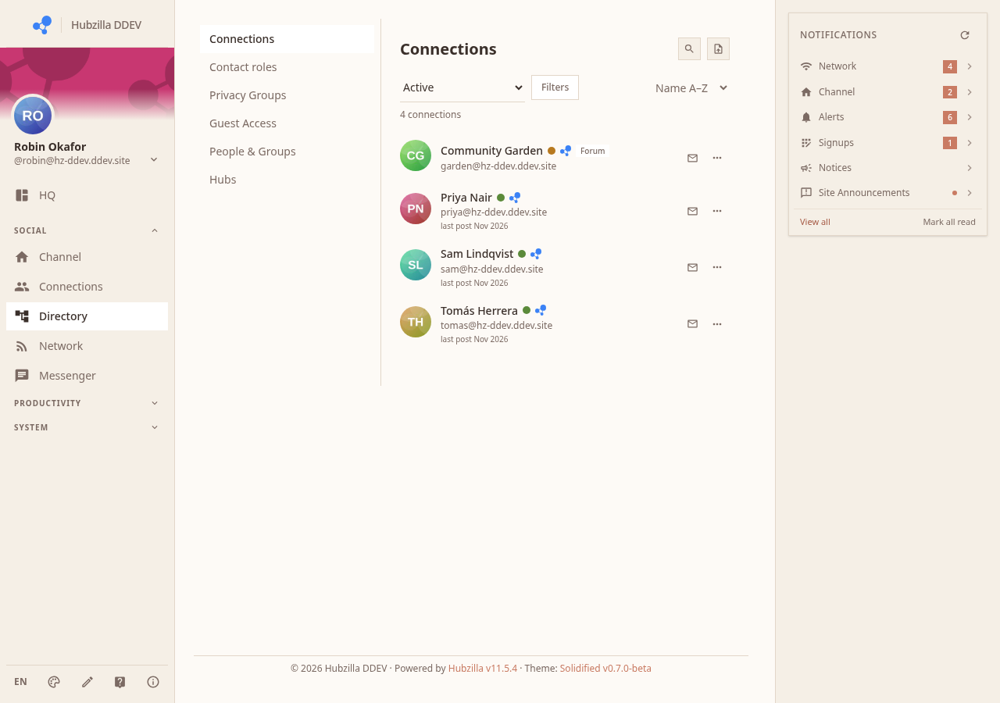
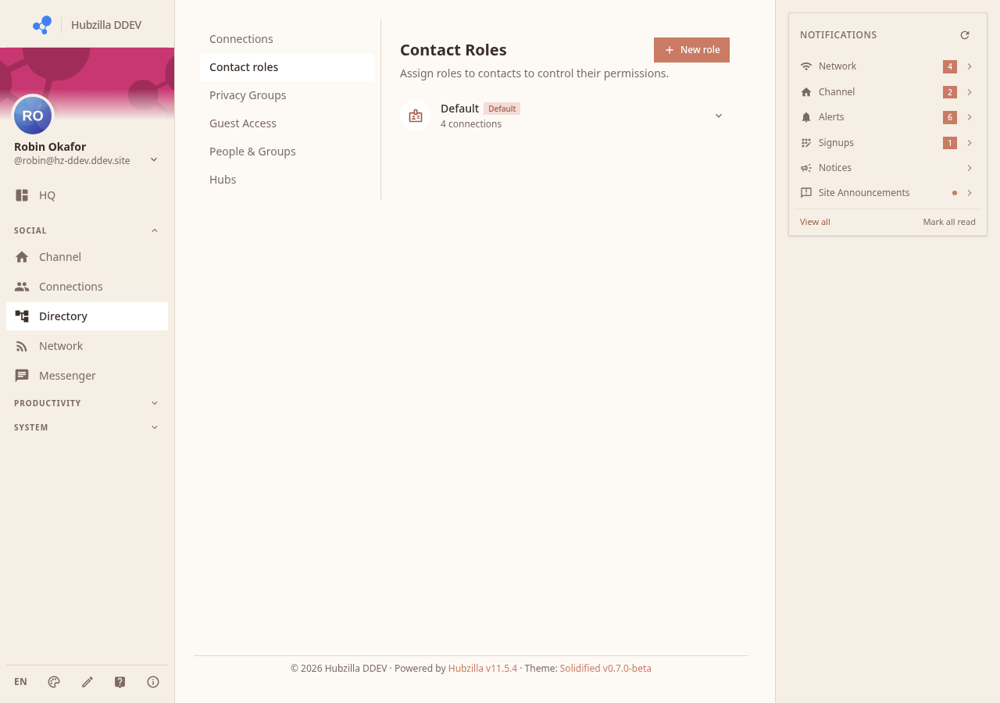
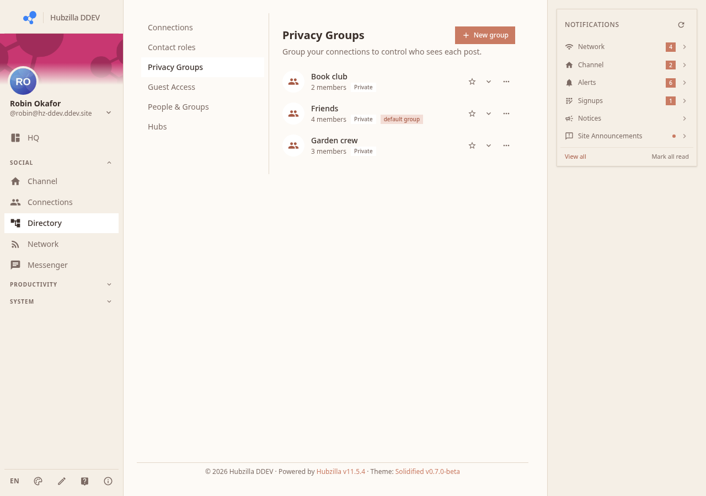
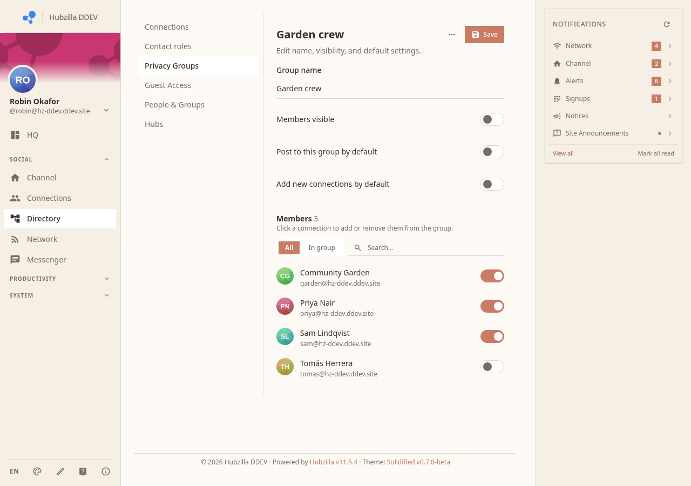
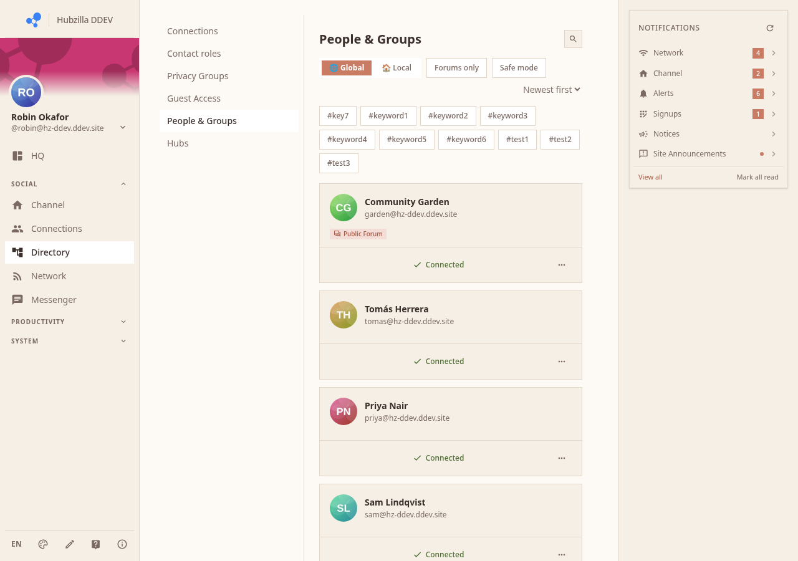
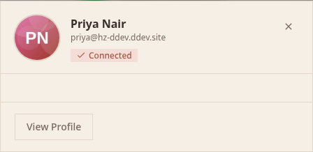
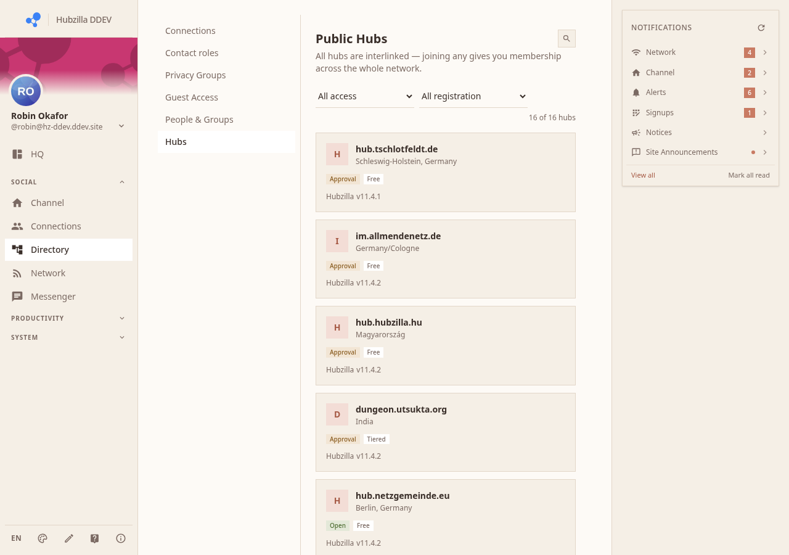

# Connections, Directory, and Privacy Groups

The Connections area (`/directory`, or **Directory** in the nav) is where you
manage who you're connected to, find new people, and sort your connections
into groups. Its sections are listed on the left. Some only appear when their
app is installed (see **Settings → Integrations**).

<!-- connections -->
## Your Connections

Everyone you're connected to.

- **Search connections…** finds someone by name or address. **Filters** narrows the list by **Status** (pending, forum, unreachable…), and **Sort by** reorders it.
- **Connect** sends a connection request: type an address and click it. **Import from CSV** adds many at once.
- A **Pending** badge means a request is waiting for you. Click **Approve** to accept it.
- **Unreachable** means every hub that contact lives on has stopped accepting deliveries.
- On each row, **Direct message** starts a private conversation. **More actions** has **Edit** (role, closeness and permissions), **Details**, **Start chatroom** and **Remove**.
- **Details** shows when you connected, your **Closeness**, the contact's **Role**, **Network** and **Address**, and what they **Accept** from you.

<!-- contact-roles -->
## Contact Roles

A role is a named set of permissions, like "Friend" or "Colleague". Each
connection has one role, and its permissions decide what that connection can
do.

- **New role** creates one. **Edit permissions** sets what it allows.
- **Automatically assign to new contacts** makes a role the **Default** for every new connection.
- **View members** lists who has the role. Pick a different role beside someone to move them.
- **Assign to group…** gives the role to everyone in a privacy group.
- **Rename** and **Delete role** manage the role itself.

<!-- privacy-groups -->
## Privacy Groups

Privacy groups are named lists of your connections. When you send a post to a
group, only its members can see it.

1. Click **New group** and give it a name.
2. Open the group and add connections to it.

**Members visible** lets members see who else is in the group. Each group's
menu has **Set as default ACL**, which makes it the audience new posts start
with, plus **Edit** and **Delete group**.

To post to a group, open the composer's privacy picker, choose **Custom**, and
pick one or more groups.

<!-- guest-access -->
## Guest Access

Guests let you share things with people who don't have a Hubzilla account.

1. Click **New guest**. Each guest gets a **Login name**, a **Login password** and a **Role** (what it can do, like a connection's role). You can also set when it **Expires**.
2. Add the guest to a post's audience, like any other contact.
3. Send them the guest link from that post's Share or padlock menu, or give them the login name and password.

**Generate a new password** stops the old one working. Deleting a guest stops
any link that uses it.

<!-- sources -->
## Channel Sources

A source copies posts from another channel into this one and shares them
according to your channel's settings. It's useful for a forum that gathers
posts from several channels.

- **New Source**: pick a connection, or **All connections**.
- **Only import content with these words**: one word per line. Leave it blank to import everything.
- **Add the following categories…**: tags every imported post.
- **Resend posts with this channel as author**: posts the copies as you. Copyright may apply.

A connection must give you **republish** permission, or nothing is imported.
**Review connection** opens their settings so you can check.

<!-- people -->
## People & Groups

The directory. Search and browse channels on this hub (**🏠 Local**) or across
the whole network (**🌐 Global**).

- **Forums only** shows only group and forum channels.
- **Safe mode** hides channels marked as adult content.
- **Sort by** newest, oldest or name. **Keywords** filter by interest.
- **Map** and **Grid** switch the view.
- Click a card to see a short profile with a **Connect** button.

<!-- suggest -->
## Suggestions

Channels you might want to connect with, chosen from the connections you
already have. Click a card to see the profile and connect.

<!-- invite -->
## Invite

Email an invitation code to someone who wants to join this hub.

1. Under **Recipients**, enter email addresses, one per line. **Check addresses** validates them first.
2. Pick an **Invite template**, edit the **Subject** and **Your message**, and look at the **Preview**.
3. Choose when the invitation expires, then click **Send invitations**.

The counters show how many invitations you, and the whole hub, have used.

<!-- hubs -->
## Public Hubs

Hubs (servers) that run Hubzilla. They're all linked together, so joining any
one makes you part of the whole network.

Search by name or location, and filter by access (**Free**, **Tiered**,
**Paid**) and registration (**Open**, **Approval**, **Closed**). **Map** and
**Grid** switch the view. Click a hub for details.

## Sending a Connection Request

Visit someone's channel page and click **Connect**, or use **Connect** on the
Connections page. Once they accept, you'll see each other's posts in your
streams.

## Managing Affinity

Each connection has a **closeness** (affinity) score from 0 to 100. Higher
means closer. The Network stream's affinity filter can show posts from your
closest connections only. Change it from **Edit** on the connection.
